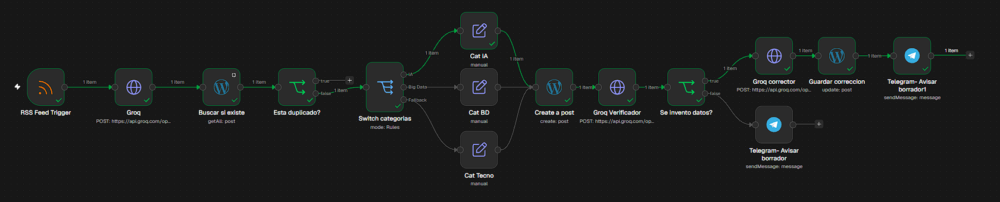
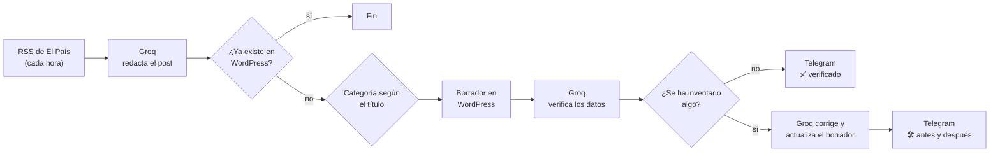
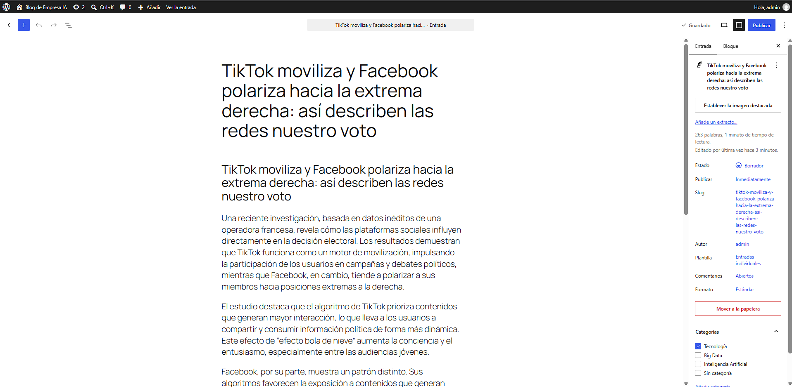
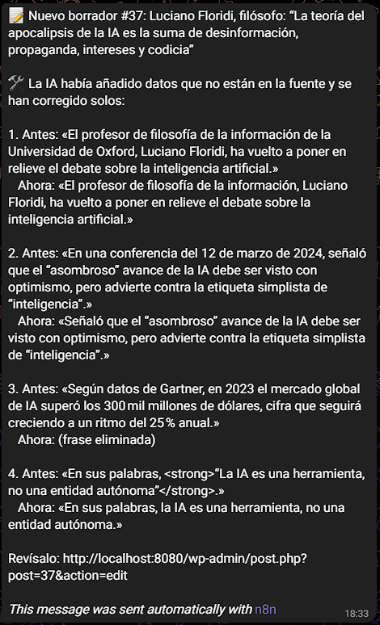

# Blog automático con IA


Flujo de **n8n** que coge las noticias nuevas de un RSS, las reescribe con IA como un post para el blog de una empresa, comprueba que la IA no se haya inventado ningún dato y deja el artículo como **borrador en WordPress**, avisando por **Telegram**.

Todo corre en local con Docker y la IA es la API gratuita de Groq, así que el coste es 0 €.

> Práctica *RA1.3 · Aplicaciones e impacto de la IA* del módulo Modelos de Inteligencia Artificial (curso de especialización en IA y Big Data).



## Cómo funciona



| Bloque | Nodos | Qué hace |
|---|---|---|
| Trigger | `RSS Feed Trigger` | Cada hora mira el RSS de Tecnología de El País y saca los artículos nuevos. |
| Redacción | `Groq` | Reescribe la noticia como un post de blog de empresa, en HTML y con 300 palabras como máximo. |
| Duplicados | `Buscar si existe` · `Esta duplicado?` | Si ya hay una entrada con ese título (publicada, borrador, pendiente o programada), para el flujo. |
| Categorías | `Switch categorias` · `Cat IA` · `Cat BD` · `Cat Tecno` | Elige *Inteligencia Artificial*, *Big Data* o *Tecnología* según el título. |
| Publicación | `Create a post` | Crea la entrada en WordPress como **borrador**, nunca la publica sola. |
| Verificación | `Groq Verificador` · `Se invento datos?` · `Groq corrector` · `Guardar correccion` | Una segunda IA busca datos que no están en la noticia original y, si los hay, otra los corrige. |
| Aviso | `Telegram- Avisar borrador` · `Telegram- Avisar borrador1` | Manda el título, el resultado de la verificación y el enlace para revisar el borrador. |

El resultado es un borrador en WordPress listo para revisar, con su categoría:



## Verificación de datos inventados

El RSS solo trae el titular y una frase de resumen, y a partir de ahí la IA escribe un artículo entero. El problema es que, para rellenar, **se inventa cosas**: cifras, fechas, cargos o citas que nadie ha dicho.

Por eso el flujo tiene una pequeña redacción dentro:

1. **Redactor** (`gpt-oss-20b`): escribe el post.
2. **Verificador** (`gpt-oss-120b`): compara el post con la noticia original y lista los datos que no aparecen en ella. Si no hay ninguno, responde `Ninguno`.
3. **Corrector** (`gpt-oss-120b`): quita o reformula solo esas frases, actualiza el borrador y devuelve la lista de cambios.

Así llega el aviso cuando ha tenido que corregir algo:

<p align="center"></p>

El verificador también es una IA y también se equivoca, así que el artículo **se queda siempre como borrador**: la última palabra la tiene una persona.

## Requisitos

- [Docker Desktop](https://www.docker.com/products/docker-desktop/) (en Windows, con WSL2).
- Una API key gratuita de [Groq](https://console.groq.com/keys).
- Un bot de Telegram, creado con [@BotFather](https://t.me/BotFather), y tu chat ID.

## Puesta en marcha

### 1. Levantar los contenedores

```bash
git clone https://github.com/hehedaniel/taller-n8n-blog-ia.git
cd taller-n8n-blog-ia
docker compose up -d
```

Se levantan tres contenedores: WordPress en `http://localhost:8080`, su MySQL y n8n en `http://localhost:5678`.

### 2. Preparar WordPress

1. Abre `http://localhost:8080` e instálalo.
2. **Ajustes → Enlaces permanentes →** *Nombre de la entrada*. Sin esto la API REST (`/wp-json/`) da 404.
3. **Usuarios → Perfil → Contraseñas de aplicación**: crea una llamada `n8n` y guárdala, solo se ve una vez.
4. **Entradas → Categorías**: crea *Inteligencia Artificial*, *Big Data* y *Tecnología*. Sus números los puedes ver en `http://localhost:8080/wp-json/wp/v2/categories`.

### 3. Crear las credenciales en n8n

Abre `http://localhost:5678`, crea tu cuenta de propietario y en **Overview → Credentials** crea estas tres:

| Nombre | Tipo | Datos |
|---|---|---|
| `Wordpress account` | WordPress API | URL `http://wordpress`, tu usuario y la contraseña de aplicación |
| `Groq` | Header Auth | Name `Authorization` · Value `Bearer gsk_...` |
| `Telegram account` | Telegram API | El token de tu bot |

> La URL de WordPress es `http://wordpress` y no `localhost:8080`: para n8n, `localhost` es su propio contenedor. Dentro de Docker los contenedores se encuentran por el nombre del servicio.

### 4. Importar el flujo

1. En n8n, crea un flujo nuevo y en el menú **… → Import from File** elige [`workflow/blog-automatico-ia.json`](workflow/blog-automatico-ia.json).
2. Abre los nodos que usan credenciales y elige las tuyas.
3. Cambia `TU_CHAT_ID` por tu chat ID en los dos nodos de Telegram.
4. Si tus categorías no tienen los números 2, 3 y 4, cámbialos en `Cat IA`, `Cat BD` y `Cat Tecno`.

### 5. Probar y activar

Pulsa **Execute workflow** para probarlo y, cuando funcione, **Publish** para que se ejecute solo cada hora. Para que siga funcionando, el PC tiene que estar encendido y Docker Desktop abierto.

## Problemas que me encontré

La guía original del taller se había quedado desactualizada. Lo que hubo que cambiar:

| Problema | Solución |
|---|---|
| WordPress no deja crear contraseñas de aplicación sin HTTPS | `WP_ENVIRONMENT_TYPE` en `local` (ya va en el `docker-compose.yml`) |
| `/wp-json/` da 404 de Apache | Enlaces permanentes en *Nombre de la entrada* |
| El usuario `admin` / `admin123` de n8n no existe | Desde la versión 1.0 n8n pide crear una cuenta de propietario |
| El RSS antiguo de El País (`tecnologia.elpais.com`) da 403 | Feed nuevo de la sección de Tecnología |
| El modelo `llama3-8b-8192` ya no existe en Groq | Modelos `openai/gpt-oss` |
| El JSON de la petición se rompe con comillas en el texto | Cuerpo montado con `JSON.stringify` |
| El modelo pequeño daba falsos positivos al verificar | `gpt-oss-120b` para verificar y corregir |
| El corrector fallaba al responder en JSON con HTML dentro | Respuesta en texto con dos marcas, `===ARTICULO===` y `===CAMBIOS===` |

## Estructura

```
taller-n8n-blog-ia/
├── docker-compose.yml           WordPress + MySQL + n8n
├── workflow/
│   └── blog-automatico-ia.json  el flujo exportado de n8n
└── docs/                        capturas del README
```

## Aviso

Es un **entorno de pruebas**. Las contraseñas del `docker-compose.yml` son las de ejemplo del taller, así que no lo expongas a Internet tal cual. El flujo exportado no lleva ninguna clave: las credenciales se quedan en tu n8n.
